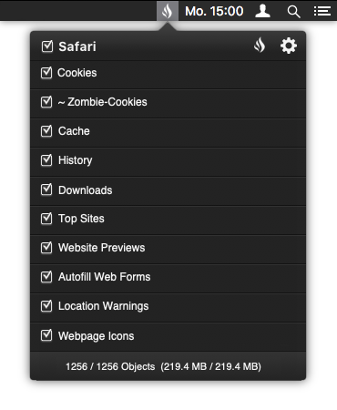
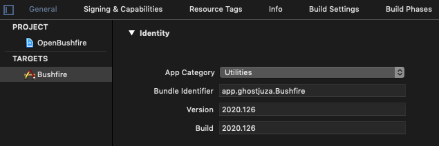

# Bushfire – Free Open-Source App to protect your privacy on any macOS Browser Safari

Bushfire is a free, open-source (GPLv3) macOS app that automatically deletes your Safari traces as soon as you quit Safari: cookies (including zombie cookies), cache, history, downloads list, Top Sites, page thumbnails, web form contents, location hints and website icons. No account or registration needed.

## Features

* Automatic deletion when Safari quits, running quietly in the background
* Immediate cleanup from the macOS menu bar, without quitting Safari
* Choose the data categories individually, pause Bushfire at any time
* Statistics: number and size of deleted items
* Optional secure overwriting
* German and English, free including updates

Safari can remove history after a set period (at the earliest after one day), but not when you quit. Bushfire closes this gap.

## Status

The app is pretty stable.  
Currently it runs up macOS 10.11 to 12.x.

## Quick Links

[Website (English)](https://bushfire-app.de/en/) · [Website (Deutsch)](https://bushfire-app.de/)  
[Release Notes](https://github.com/ghostjuza/open-bushfire/releases)  
[Legacy Release Notes](https://github.com/ghostjuza/open-bushfire/blob/master/releasenotes.md)  

Twitter: [bushfireapp](https://twitter.com/bushfireapp)  
Discord: [Open Bushfire App](https://discord.gg/pcw93z63Eh)  

## Guides

English:

* [Delete Safari history automatically](https://bushfire-app.de/en/guides/delete-safari-history-automatically/)
* [Delete Safari cookies automatically](https://bushfire-app.de/en/guides/delete-safari-cookies-automatically/)
* [Delete Safari cache automatically](https://bushfire-app.de/en/guides/delete-safari-cache-automatically/)
* [All guides](https://bushfire-app.de/en/guides/)

Deutsch:

* [Safari Verlauf automatisch löschen](https://bushfire-app.de/de/ratgeber/safari-verlauf-automatisch-loeschen/)
* [Safari Cookies automatisch löschen](https://bushfire-app.de/de/ratgeber/safari-cookies-automatisch-loeschen/)
* [Safari Cache automatisch löschen](https://bushfire-app.de/de/ratgeber/safari-cache-automatisch-loeschen/)
* [Privates Surfen in Safari](https://bushfire-app.de/de/ratgeber/privates-surfen-safari/)
* [Safari anonym machen](https://bushfire-app.de/de/ratgeber/safari-anonym-machen/)
* [Alle Ratgeber](https://bushfire-app.de/de/ratgeber/)

## Contributing

Here's a [list of issues](https://github.com/ghostjuza/open-bushfire/issues) where your help would be very welcome.

### Important notes for pull requests

* work with feature or hotfix branches
  * create your **feature** (feature/...) or **hotfix** (hotfix/...) branch always from `master`
  * push your feature or hotfix branch to your own forked repo
  * create a **Pull request**: [YourBranch] to [ghostjuza/open-bushfire:master]
* please respect existing style in code, styles, and markup
* don't add any dependencies, sniffer, spycode, malware, ...
* write clean code
* test your code
* refactoring welcome
* please don't change `Version` and `Build` fields. They are will be set automaticly!  

## Donations

Bushfire is not free to develop. It takes time, requires paid certificates and domains.  
You can help the project or say "thank you" with this button:

Please note: donation does not imply any type of service contract.

## License

Bushfire - A free Open-Source App to protect your privacy on any macOS Browser Safari.

Copyright (c) Open Bushfire Community. All rights reserved.

This program is free software: you can redistribute it and/or modify
it under the terms of the GNU General Public License as published by
the Free Software Foundation, either version 3 of the License, or
(at your option) any later version.

This program is distributed in the hope that it will be useful,
but WITHOUT ANY WARRANTY; without even the implied warranty of
MERCHANTABILITY or FITNESS FOR A PARTICULAR PURPOSE. 
See the GNU General Public License for more details.

[GPL3](https://github.com/ghostjuza/open-bushfire/blob/master/LICENSE)

## Special Thanks

@Alexander Gärtner, Sponsor

### Libraries

software update framework [Sparkle](https://sparkle-project.org)
