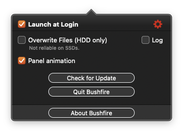
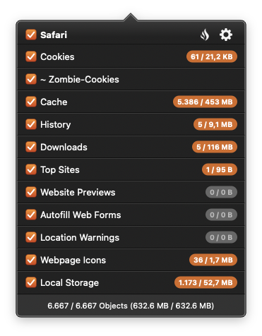

# Release Notes

### Build 2026.109 (2026-11-13)
`new` Added a 'Panel animation' option in the settings to switch the panel's opening and collapsing animation off.

  

---

### Build 2026.109 (2026-11-13)
`fix` Cleanup: Runs are now executed one after another; the temporary folder is only readable by you.  
`fix` Cache: Nested folders are no longer counted twice.  
`fix` Statistics: If the server is unreachable, results are stored and sent later.  
`fix` Several small memory leaks fixed.  
`fix` Downloads: Files listed in Safari's download list are now correctly found, counted and removed. Safari stores absolute paths, which Bushfire did not recognize before.  
`fix` Download history: The quarantine database is now always cleaned thoroughly, so deleted entries no longer remain re adable in the file.  
`improve` Cookies: Bushfire now counts the cookies actually stored in Safari's cookie files instead of just the files.  
`improve` Footer: Object counts now use the thousands separator of your system language.  
`change` "Overwrite files" is now labeled "Overwrite Files (HDD only)", with a hint and tooltip. Overwriting is not reliable on SSDs; FileVault is the better protection there.  
`notice` Hide badge for Zombie-Cookies.  

---

### Build 2026.85 (2026-11-12)
`new` Per-category badges: Every category in the panel now shows how many objects it contains and how much space they use, for example 1,200 / 567 MB. Categories with nothing to clean show a gray 0 / 0 B. The badge dims when you turn the category off.  
`new` Wider panel: The panel is 20 px wider so the badges fit next to the longest category names.  
`improved` Smoother panel: Counting objects and data size no longer runs on the main thread, so the panel stays responsive even with a large Safari cache or history.  
`improved` Faster scanning: Scanning folders needs fewer resources, and the categories are scanned in parallel in the background.  
`improved` Instant toggling: Switching a category on or off updates the totals immediately without rescanning your disk.  
`improved` Latest scan wins: When you click quickly, only the most recent scan is shown.  
`fix` Double counting: One Safari history file was counted twice. Object counts and sizes in the panel and the anonymous cleanup statistics can be slightly lower than before, but they are now accurate.  

  

---

### Build 2026.75 (2026-11-11)
`fix` On macOS 12, the menu bar panel occasionally needed multiple clicks to open.  
`change` Change to a fix checkbox color.  

---

### Build 2026.50 (2026-11-10)
`notice` END OF SUPPORT macOS 10.11  
`notice` macOS 11.5 is now the minimum OS version  
`notice` App is now properly signed and notarized
`improved` Remove more Website Data  
`improved` Alignments for Panel View

---

### Build 2022.235 (2022-10-02)
`improved` handle SIP status: enabled, disabled, unknown  
`improved` FullDiskAccess handle  
`notice` Remove AuthorizationManager  

---

### Build 2022.190 (2022-10-01)
`notice` Some improvements and fixes  
`fix` Issue [#28](https://github.com/ghostjuza/open-bushfire/issues/28)  
`fix` Issue [#36](https://github.com/ghostjuza/open-bushfire/issues/36) > Add new checkbox to enable/disable logging

[Log] diabled: log absolute nothing  
[Log] enabled: log several informations and errors

  

---

### Build 2022.77 (2022-09-20)
`fix` Issue [#23](https://github.com/ghostjuza/open-bushfire/issues/23)  
`fix` Issue [#31](https://github.com/ghostjuza/open-bushfire/issues/31)  

---

### Build 2022.71 (2022-09-19)
`fix` Delete local storage files  

---

### Build 2022.28 (2022-05-14)
`fix` Issue [#19](https://github.com/ghostjuza/open-bushfire/issues/19) (icew4y)  
`notice` Raise minimum macOS version 10.11  

---

### Build 2022.22 (2022-05-12)
`fix` the correct target system.  
`notice` readme changes for pull requests.  
`notice` Raise minimum macOS version 10.11  

---

### Build 2022.16 (2022-05-11)
`fix` Service call.  
`notice` Raise minimum macOS version 10.11  

---

### Build 2022.10 (2022-05-11)
`fix` Issue [#17](https://github.com/ghostjuza/open-bushfire/issues/17) (icew4y)  

---

### Build 2020.385 (2020-01-27)
`improved` push exactly burn data count and size at webservice.  
`improved` detect burn data count and size.  
`notice` **last release for minimum macOS version 10.7**  

---

### Build 2020.279 (2020-01-26)
`improved` Implementation.  
`new` Push total file count and size of cleanup to webservice.  

---

### Build 2020.200 (2020-01-23)
`improved` **GHI-#7** Check system integrity protection and full disk access and show an alert.  
`improved` **GHI-#2** Compatibility for macOS Catalina Safari Browser.  

---

### Build 2020.121 (2020-01-22)
`change` **GHI-#4** Rename Bundle Identifier.  
`new` Check system integrity protection and show a warning, if it is enabled.  
`improved` Cleanup rules.  
`fix` Code signing.  

---

### Build 2020.21 (2020-01-18)
`notice` Launch Open Bushfire App.  

---

### Build 2019.12 (2019-12-27)
`fix` App crash on macOS High Sierra and Mojave.  

---

### Build 2019.0 (2019-05-01)
`notice` Bushfire.app now an Open-Source App under GNU General Public License v3.0.  
